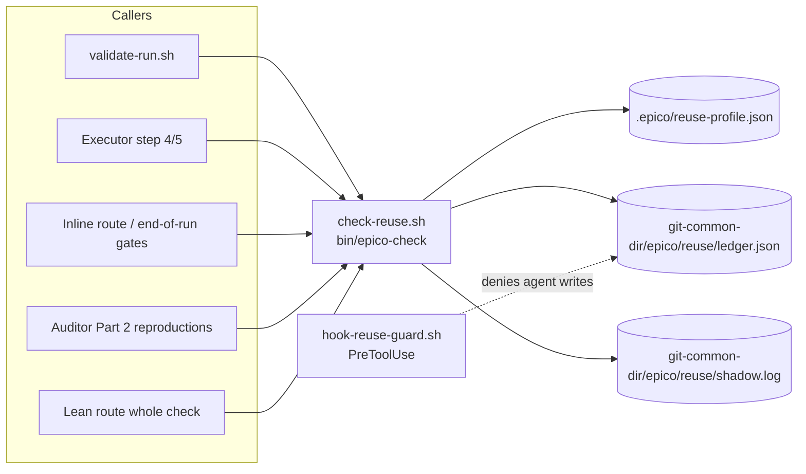
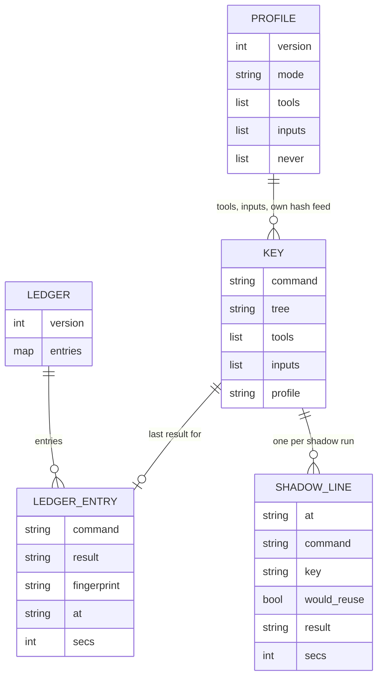
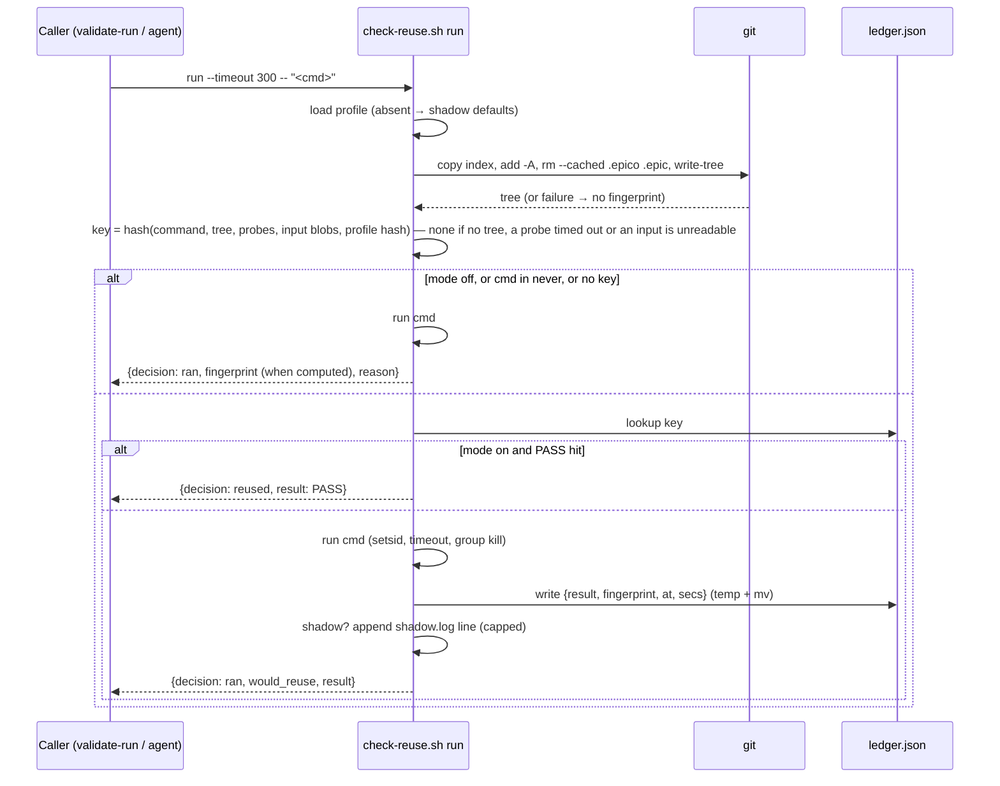

# Design - Validation Result Reuse

## Overview

Today every check runs again, even when the code it reads has not changed. The same validation command can run up to seven times in one story: Executor step 4, Executor step 5, the end-of-run gates, `epico-validate-run`, the Auditor's reproductions, a fix round, and pre-commit. This story adds **exact reuse**: a check whose command, code fingerprint and environment key equal those of its last PASS is not run again. It also fixes the `--only` bug that drops entries from the report, and rewrites the gate guidance that forces suites into one command.

Key decisions:
- **One script owns the run.** `scripts/check-reuse.sh` behind `bin/epico-check`. It is the only writer of the ledger.
- **Shared ledger.** The ledger lives in the git common dir, so every worktree of a repository shares it.
- **Per-project profile.** `.epico/reuse-profile.json` adds tool versions and ignored inputs to the key, lists the commands never reused, and holds the mode switch.
- **Shadow is the default mode.** Nothing is reused until a person switches the project to `on`.

Evidence (benchmark 2026-11-02 on a pnpm/turbo monorepo, 13 gates, 5 injected-failure scenarios): total 147 → 46 min. Exact reuse alone removed 47.9 min. Fingerprint cost was 8–20 ms on five repositories of 881–5256 tracked files, across Node/turbo, Go, Prisma, a serverless worker with a PHP plugin, and Makefile/mutation testing.

**Project-agnostic by rule.** Nothing this story ships — code, references, agent text, tests or examples — names a real project. The Epico analyses each project on its own (the profile is detected per repository), and its stored instructions describe *cases* ("a gitignored `.epico/` holding a tracked file"), never *projects*. The evidence above is described the same way.

## Architecture

Some callers keep running their command directly and **never** route through `epico-check`:
- the Test Advisor's Red runs (`agents/test-advisor.md`, "Red" verification);
- the deferred E2E Red run before the Executor (`references/run-mode.md`, Deferred E2E);
- the Auditor's bugfix "guard must bite" on the base commit (`agents/auditor.md`);
- the final reviewer's clean-copy run (`agents/final-reviewer.md`, the `mktemp -d` copy).

A run that must see a FAIL, or must run somewhere other than the working tree, is the opposite of a reusable PASS.

## Components & Interfaces

### check-reuse.sh (`bin/epico-check`)

- **Responsibility:**
  - compute the reuse key;
  - look up the ledger and decide `ran` | `reused`;
  - run the command with validate-run's semantics: own session, timeout, process-group kill, last-line evidence;
  - record the result in the ledger, and in shadow mode append one line to `shadow.log`.
- **Interface** — one JSON line on stdout, diagnostics on stderr. Exit 0 = PASS (run or reused), 1 = FAIL, 2 = bad usage. Usage errors print no JSON (`close-subtask.sh` convention).

| Subcommand | Purpose | Output (JSON keys) |
|---|---|---|
| `run [--fresh] [--timeout <s>] -- <command>` | Decide, run or reuse, record | `mode`, `decision` (`ran`\|`reused`), `would_reuse` (bool), `result` (`PASS`\|`FAIL`), `exit`, `evidence`, `secs`, `fingerprint` (string\|null), `key` (string\|null), `reason` |
| `lookup -- <command>` | Report what `run` would decide, running nothing. `validate-run.sh` reads `fingerprint`; `last` is for a person diagnosing a decision | `mode`, `would_reuse`, `fingerprint`, `key`, `last` (ledger entry\|null), `reason` |
| `stats` | Summarise shadow.log | `runs`, `would_reuse`, `agreed`, `disagreed` (list of `{command, at}` — `at` is a UTC timestamp), `secs_reusable` |
| `profile --detect` | Print a proposed profile; writes nothing | the profile object |

- **There is deliberately no `record` subcommand.** A result enters the ledger only as the outcome of a `run`, so no caller can write a PASS it did not run.
- **Dependencies:** bash, jq, git, plus `setsid` and `timeout`, which validate-run.sh already uses.

### Reuse key

`key = git hash-object --stdin` of a canonical JSON document, with these fields:
- `command`: the exact command string;
- `tree`: the fingerprint below;
- `tools`: one `{probe, output}` per profile probe. `output` is the git blob hash of the probe's captured stdout+stderr, so a megabyte of output never meets the argument-size limit; it is null when the probe's first word is a plain name that is not on PATH. A first word that is shell syntax (`VAR=1 tool`, a quoted word) is never called absent: bash runs it, and its output is the environment;
- `inputs`: one `{path, blob}` per profile input, where `blob` is `git hash-object --no-filters -- <path>`, or `absent`;
- `profile`: the hash of the profile file itself, so editing the profile invalidates every key.

**Fingerprint:**
1. Copy the real index (`git rev-parse --git-path index`) to a temp file beside it in the git directory, with `cp -p`: the copy keeps the real index's mtime.
2. `GIT_INDEX_FILE=<temp> git add -A -- .`
3. `git rm -r -q --cached --ignore-unmatch -- .epico .epic`
4. `git write-tree`
5. Delete the temp file.

**No fingerprint is produced** for:
- a directory that is not a git work tree;
- any failure of steps 1–4 (an unreadable file, for example);
- a submodule or nested repository with uncommitted content: after `add -A`, each gitlink (mode 160000) in the temp index is checked with `git -C <path> status --porcelain`.

With no fingerprint, `run` runs the command and records nothing reusable.

**The fingerprint is always reported when it can be computed**, in every mode and for never-list commands too. Not writing to the ledger is a separate decision. `validate-run.sh --only` relies on the fingerprint to keep an unchanged PASS, so a row that skips it would make `--only` re-run unchanged entries.

**Probes and inputs:**
- Each probe runs from the repository's top level under `timeout "${EPICO_REUSE_PROBE_TIMEOUT:-10}" bash -c "<probe>"`; a limit of 0 or a non-number means the default 10. Its output is captured even when it exits non-zero; `java -version`, for one, prints to stderr.
- With no `timeout` binary on PATH there is **no key**, with a reason: a probe run unbounded, or not run, would key on an error text.
- A probe that times out gives **no key**, with a reason naming the probe. The command still runs.
- A profile input that exists but is a directory, a FIFO or another non-regular file, or unreadable, gives **no key**, with a reason naming the input. The command still runs.
- In both cases a stable placeholder would hide a real change, so no key is safer than a wrong one.

### Decision table (`run`)

The `fingerprint` key in the output is filled whenever it can be computed, in every row (see above).

| Mode | Fingerprint | Ledger has PASS for key | Command in `never` | `--fresh` | Decision | Ledger write | shadow.log |
|---|---|---|---|---|---|---|---|
| `off` | — | — | — | — | ran | no | no |
| any | none | — | — | — | ran | no | no |
| any | yes | — | yes | — | ran | no | no |
| `shadow` | yes | yes/no | no | no | ran (`would_reuse` = ledger hit) | yes | yes |
| `on` | yes | yes | no | no | **reused** | no | no |
| `on` | yes | no | no | no | ran | yes | no |
| `shadow`/`on` | yes | — | no | yes | ran | yes (overwrites) | shadow only |
| any | — | — | — | — | **not started** (no `setsid` or `timeout`, no temp file): FAIL, exit 126 | no | no |

**Only a PASS is ever a hit.** A FAIL is recorded so `stats` can count disagreements, but it is never reused.

**`run` details.** The command runs from the git top level (the current directory outside git), in its own session; a signal to the runner stops that session's process group. A hit returns `decision: reused`, `secs: 0` and the evidence `reused: PASS recorded <time>`: the ledger keeps the verdict, not the output.

### reuse-profile.json

- **Responsibility:** the per-project reuse configuration, reviewable by a person.
- **Format: JSON, not YAML.** jq is the only parser the constitution allows.
- **Shape:** `{"version": 1, "mode": "shadow", "tools": ["node --version", "pnpm --version"], "inputs": ["apps/api/.env.test"], "never": ["scripts/ci-local.sh --only <job-that-needs-real-credentials>"]}` (placeholder shown here only; a real profile holds real command substrings).
- **`never` entries are literal substrings** of the command.
- **Absent file:** `mode` = `shadow` and empty lists. Every JSON output carries `reason: "profile absent"`.
- **Invalid JSON:** treated as absent, with a stderr warning. Never a crash.
- **`--detect`** proposes a profile and writes nothing:
  - **`tools`**, from the manifests present, and only for binaries on PATH:
    - `package.json` → `node --version` plus the `packageManager` tool's `--version`;
    - `go.mod` → `go version`;
    - `Cargo.toml` → `rustc --version`;
    - `pyproject.toml`/`requirements*.txt` → `python3 --version`;
    - `composer.json` → `php --version`;
    - `build.gradle*`/`pom.xml` → `java -version`;
    - `Gemfile` → `ruby --version`;
    - `deno.json*` → `deno --version`.
  - **`inputs`**: gitignored files named `.env`, `.env.*`, `.dev.vars` or `*.local.{json,yaml,yml,toml,php}`, outside `node_modules/` and `vendor/`.
  - **`never`**: left empty. Which commands need credentials, docker or a live service is a judgement made at init, not detected.

### Ledger and shadow log

- **Location:** `$(git rev-parse --path-format=absolute --git-common-dir)/epico/reuse/`.
- **`ledger.json`:** `{"version": 1, "entries": {key: {command, result, fingerprint, at, secs}}}`, capped at **2000 entries**: the oldest `at` of the *other* entries is dropped first, and the entry just written never is, whatever its timestamp says.
- **The directory also holds** `ledger.lock/` (a lock directory, below) with its `owner` token, `ledger.lock.break` while a stale lock is being broken, `void.<key>` markers (below), temp files `ledger.XXXXXX` and `shadow.XXXXXX`, and set-aside copies. All of it is under the git directory, so none of it is part of the fingerprint.
- **The read-modify-write runs under a `mkdir` lock** (`ledger.lock`), because parallel runs share the ledger and a slow run could write back the ledger it read before a newer FAIL was recorded, putting a stale PASS back in play. No flock, which is absent on macOS.
  - **The owner file decides who holds it.** `mkdir` alone is not a lock everywhere: uutils' `mkdir` (0.10.0, the default coreutils on Ubuntu 26.04 and in the CI image) lets racing callers both succeed. So right after its `mkdir` a run creates `ledger.lock/owner` holding its token (pid and `$RANDOM`) under `set -o noclobber`, which bash opens with `O_EXCL` — one creator wins, on any coreutils and in bash 3.2. A run that loses that create removes the directory only if it is empty (`rmdir` refuses another holder's) and waits like any waiter; a token that cannot be created is no lock.
  - **The wait counts one holder:** about 5 s (50 tries, 0.1 s apart), restarted whenever the owner token changes, so a queue of writers handing the lock on never makes a newer FAIL give up. A lock with one owner, or none, past the budget is given up on — but only after the owner is read once more: a lock another run broke and took in the meantime is a new holder, waited on afresh (R4.13).
  - **A stale lock** — older than a minute — belonged to a killed run and is broken, by one run at a time (R4.14). The breaker first creates `ledger.lock.break` under `noclobber` (`O_EXCL`); with it held, nobody else moves the lock, and a lock holding an owner cannot be claimed, so the breaker checks once more that the lock is still stale and its owner is still the one it judged dead, and only then moves it aside and removes the break file. A run that cannot create the break file because another holds it waits as before; a break file older than a minute belonged to a breaker that was killed, and is removed. A stale lock that cannot be broken — the break file or the move cannot be made, the directory not writable — is given up on, never waited on again (R4.10).
  - **Release** removes `owner`, then the directory, and only while `owner` still holds this run's token: a run whose lock was broken as stale leaves the new holder's lock alone (R4.11). `cleanup` releases the same way on a signal.
  - **A lock that cannot be taken** means the result is not recorded, with a warning, and a non-PASS voids its key.
- **Void markers (`void.<key>`)** keep a dropped non-PASS from leaving an older PASS reusable (R4.9):
  - **Made** when a non-PASS is not recorded — the lock was given up on, or the write under the lock failed (`mktemp`, `jq` or `mv`). One empty file — written without the lock after a give-up, under it after a failed write — with `true` and never `:` (a failed redirection on a special builtin ends a POSIX-mode shell). A marker that cannot be written is named in the warning.
  - **Read** by `prepare`: a voided key is no hit, for `run`, `lookup` and shadow's `would_reuse` alike, and its `reason` says the key is void.
  - **Cleared** by the key's next locked write, unless the marker is newer than that write's lock — a FAIL that waited on this very write keeps its void.
  - **Bounded:** every locked write removes the markers whose key has no ledger entry (R4.12), so there are never more markers than entries.
- **Only the locked write mutates the ledger.** `lookup` and the read that precedes a run never set an unreadable ledger aside; `run` does it inside the lock, right before it records.
- **An unreadable ledger** — invalid JSON, a wrong shape, or a `version` other than 1 — is never overwritten in place. It is renamed to `ledger.json.unreadable-<UTC timestamp>`, a name that never replaces an earlier set-aside copy, and a fresh ledger starts empty.
- **`shadow.log`:** JSON lines `{at, command, key, would_reuse, result, secs}`, capped at **5000 lines**; the oldest are dropped first.
- **Every write** goes to a temp file in the same directory, followed by `mv`. The entry is built in the same `jq` call as the merge, from `--arg` values, and the ledger goes in on stdin, so neither a 100 KB command nor 2000 entries meet the argument-size limit. A shadow line starts on a new line when the log lost its final newline.

### validate-run.sh (changed)

- **P0:** `--only` with no previous `validation-run.json` exits 2: `validate-run.sh: --only needs a previous full run; run without --only first`.
- **Each runnable entry runs through `check-reuse.sh run --timeout "$TIMEOUT"`**, called by path. A script-to-script call, as validate-run already calls nothing through a wrapper. Its own `run_cmd`/`runner_totals` move into check-reuse.sh unchanged.
- **Entry JSON gains `reused` (bool) and `fingerprint` (string|null).** Both are additive. `kind`, `id`, `result`, `qualifier` and `detail` are unchanged. The YAML report gains **only** `reused:` on each result and gate; the fingerprint stays in the JSON, its only reader.
- **An unusable `lookup`** (non-zero exit, no JSON or invalid JSON) counts as an unknown fingerprint, and the entry is re-run.
- **Under `--only`:**
  - an unselected previous entry whose `result` is PASS is kept **only if** its `fingerprint` equals the current one;
  - otherwise it is re-run;
  - an entry with no `fingerprint` (a pre-030 report) is re-run;
  - SKIP and JUDGE entries are kept as today.
- **`--fresh`** is passed through to every `run`.

### hook-reuse-guard.sh (new, PreToolUse)

- **`Edit|Write`:** deny when `tool_input.file_path` resolves inside `<git-common-dir>/epico/reuse/`.
- **`Bash`:** deny a command that names that directory and holds a redirection or `mv`/`cp`/`tee`/`rm` into it, **whatever else it runs**. There is no exemption for a command that also calls `epico-check`. The runner writes the ledger itself, never through the text of an agent's command, so it needs none, and an exemption would let `cp forged.json <dir>/ledger.json && epico-check stats` through.
- **Fails open on its own error** (constitution, Architecture).
- **The deny message** names the rule: the ledger is written only by `epico-check run`.

### Reference: check-reuse.md (new)

- **The single home of the reuse rules:** which callers route through `epico-check`, which never do and why, the modes, and how to read `epico-check stats`.
- **Short pointers to it,** because run-mode.md is at 489 of the 500 lines `tests/file-size.bats` allows:
  - `agents/executor.md` steps 4 and 5;
  - `agents/auditor.md` Part 2;
  - `references/run-mode.md` (inline route, end-of-run gates);
  - `references/lean-route.md`;
  - `references/validate-mode.md`.
- `references/init-mode.md` calls `epico-check profile --detect` directly (see "init / doctor"), so it needs no pointer.

### Gate guidance (P3)

- **`quality-catalog.md:106`** (the sentence beginning "The first backtick span of a gate is the whole command validate runs"): the "one command that loops over them — `for t in a b; …`" clause becomes **one gate line per target, sharing the legend's `Qn`, each with a distinct text prefix** — `- [ ] Q5 — Unit tests (api): …`, `- [ ] Q5 — Unit tests (checkout): …`. Per-target lines are what can be reused one by one, and `close-subtask.sh` already refuses an ambiguous `gate:` prefix (`record_candidate` counts every match).
- **`tasks.md:273`** ("one box per line of the story's `## Quality Requirements` legend") becomes "one or more boxes per legend line — one per target".
- **New subsection in quality-catalog.md:**
  - **Never switch a tool's own cache off in a gate:** turbo `TURBO_FORCE`/`--force`, nx `--skip-nx-cache`, jest `--no-cache`, pytest `--cache-clear`, gradle `--rerun-tasks`/`--no-build-cache`.
  - **`go test -count=1` only for tests that read external state** (a database, the network).
  - **Prefer incremental modes**, such as Stryker `incremental`.
  - **Never write a gate whose command already runs another gate's command.** For example, a `make test` target that already runs the unit suite, beside a `make test-unit` gate that runs it again.
  - **No project names in the guidance.** Every example is generic.

### init / doctor (changed)

- **`init`** (and `init --repair`) runs `epico-check profile --detect`, shows the proposal in one line, and writes `.epico/reuse-profile.json` with `mode: shadow`. The requester adds `never` entries at that point.
- **`doctor.sh --summary`** warns `no reuse profile — run /epico:epico init --repair` when `.epico/` exists without one.

## Data Models

## Sequence Diagrams

## Error Handling Strategy

- **Not a git repo, git failure, unreadable file, dirty submodule:** no fingerprint. The command runs, `reason` names the cause, nothing reusable is recorded.
- **Profile invalid JSON, a wrong shape, several JSON documents, a tool or input holding a newline, or unknown `version`:** treated as absent, with a stderr warning. The profile is never modified by `epico-check`. A missing probe binary gives null in the key, which stays stable.
- **Ledger unreadable** (invalid JSON, wrong shape, unknown `version`): set aside under a timestamped name, never overwritten; reuse restarts from an empty ledger, which only costs runs.
- **Ledger or shadow.log write failure:** stderr warning. The command's result is still returned and the exit code is the command's. Reuse is an optimisation, never a reason to fail a check. Every write and every `mkdir` of the reuse directory is called with its error handled; none relies on `set -e`.
- **Setting an unreadable ledger aside fails** (read-only directory): stderr warning; the check runs as if nothing were recorded.
- **A probe times out, or an input is unreadable:** no key, with a reason; the command runs.
- **`profile --detect` meets a malformed manifest or no git work tree:** it skips what it cannot read (the `packageManager` probe; the inputs), warns, and still prints a profile with exit 0.
- **`lookup` is unusable inside `validate-run.sh --only`:** the entry is re-run.
- **Two writers at once:** serialised by the ledger lock (see Ledger). A lost update is not always the safe direction: an older PASS written back over a newer FAIL for the same key would be reused in mode `on`.
- **A non-PASS that cannot be recorded** (the lock given up on, a failed write under it): warn, keep the verdict and exit code, and void the key, so its older PASS is not reused (R4.9).
- **The command cannot be started** (no `setsid` or `timeout`, no temp file): FAIL with exit 126, and nothing is recorded, so it can never replace a real PASS.
- **`stats` on an unreadable or garbled shadow log:** lines that are not objects are skipped, a non-numeric `secs` counts as nothing, an unreadable log gives zeros with a warning. It always prints its JSON.
- **Timeout:** exit 124, mapped to FAIL with evidence `timed out after <s>s`, as validate-run does today.
- **Hook failure:** fail open.

## Security Considerations

- **Forged PASS:** there is no `record` subcommand; the hook denies every agent write into the ledger directory, with no exemption; a `run` records only what it ran. Residual: a caller can still run a different command that passes, which records a PASS for *that* command only. The Bash check is pattern-based, so an obfuscated write (a variable holding the path) can slip past it.
- **Secrets:** `inputs` enter the key as git blob hashes. Their content is never stored. The ledger stores command strings, so a gate that embeds a token in its command stores it under `.git/` (never committed). check-reuse.md says to keep secrets out of gate commands.
- **Ledger location:** under the git dir, so it is never committed and never part of the fingerprint.

## Performance Considerations

- **Fingerprint:** 8–20 ms measured on 881–5256 tracked files. Copying the real index keeps git's stat cache; an empty temp index would re-hash every file.
- **Probes:** one process each, computed once per `run`.
- **Ledger:** bounded at 2000 entries and shadow.log at 5000 lines, so jq reads stay small.
- **Loose objects:** `git add` on the temp index writes blobs for changed and untracked files. They are unreferenced, and `git gc` prunes them. The script never runs gc.

## Testing Strategy

- **Unit tests** (bats, one file per sub-task: `tests/check-reuse-{fingerprint,key,run,ledger,shadow,profile}.bats`):
  - **Fingerprint across `.epico` states:** versioned, gitignored, gitignored-with-a-tracked-file.
  - **Fingerprint absent:** non-git dir, dirty submodule.
  - **Key changes** when an `inputs` file changes, when a probe's output changes, and when the profile changes.
  - **Decisions:** the decision table rows (off, shadow, on hit/miss, never, `--fresh`, FAIL never reused).
  - **Caps:** ledger cap 2000, shadow.log cap 5000.
  - **The lock and the void** (`tests/check-reuse-lock.bats`, `tests/check-reuse-void.bats`, `tests/check-reuse-lock-release.bats`, `tests/check-reuse-lock-claim.bats`, `tests/check-reuse-lock-stale.bats`): with a `mkdir` that lets every racer succeed, one run holds the lock at a time; several waiters on a stale lock all record, one breaks it, and a breaker never moves a lock another run just took; a queue of holders never makes a FAIL give up; a dropped non-PASS voids its key on every path; a void is cleared, named and bounded; a stale lock that cannot be moved ends the wait; release leaves another holder's lock alone.
  - **Contract:** usage errors exit 2 with no JSON; JSON contract keys.
  - **`profile --detect`** on fixture manifests.
  - **`stats`** counts.
- **Integration tests** (bats, real temp git repos):
  - **validate-run.sh:**
    - `--only` with no prior run exits 2;
    - `--only` keeps a PASS only when its fingerprint is unchanged and re-runs it otherwise;
    - a pre-030 report entry is re-run;
    - `reused`/`fingerprint` appear in the JSON, and `reused:` in the YAML.
  - **Readers unchanged:** `run-report.sh`, `report.sh` and `checkbox-grammar.bats` still pass.
  - **Guard:** `hook-reuse-guard.sh` denies Edit/Write and redirecting Bash into the ledger dir, and allows everything else.
  - **Gates:** a story with two `Q5 — …` gate lines validates clean, and `close-subtask.sh` closes each by its distinct prefix.
  - **Wrappers:** `bin-wrappers.bats` lists `check`.
  - **Worktrees:** a run in a linked worktree hits the PASS recorded in the main one.
- **E2E tests:** none (tool: `none`). A bash plugin with no UI.

## Tooling Decisions

- E2E tool: none — not applicable (bash plugin, no UI)
- Frontend aid: none
- Recommendation surfaced: no

## Integration Points

- **`scripts/validate-run.sh`:**
  - `:109-127`: `run_cmd`, with the comment "Output goes to a file, not a pipe";
  - `:132-138`: `runner_totals`, which moves to check-reuse.sh;
  - `:150-172`: `check()`, which calls `check-reuse.sh run`;
  - `:174-179`: the `PREV='[]'` / `--only` merge, the P0 fix;
  - `:193-209`: the JSON and YAML writers, which gain the new fields.
- **Readers of `validation-run.json` / `validation-report.yaml`:** `scripts/run-report.sh:8`, `scripts/report.sh`, `tests/checkbox-grammar.bats:588`. Fields are additive only.
- **`tests/fast-verification.bats`:** `setup()` `:11-65`, the `--only` case `:108-118`, and the six cases calling `--only` with no prior run (`:122, :198, :210, :225, :232, :240`). Each gets a full run first.
- **`tests/bin-wrappers.bats:19`** (the hand-kept wrapper list) gains `check`. `\bepico-check\b` does not match `epico-checkpoint`.
- **Wrapper pattern:** `bin/epico-validate-run`'s `exec bash "$(dirname "$0")/../scripts/<x>.sh" "$@"`.
- **`hooks/hooks.json` PreToolUse:** add `hook-reuse-guard.sh` to the `Edit|Write` and `Bash` matchers, beside `hook-executor-guard.sh`.
- **Callers to route** (pointers to check-reuse.md):
  - `agents/executor.md:94` (step 4 "Run the Validation command") and `:100` (Refactor re-runs);
  - `agents/auditor.md` Part 2 claim reproduction;
  - `references/run-mode.md` inline route `:130-150` and end-of-run gates `:468`;
  - `references/lean-route.md:37` (the whole check);
  - `references/validate-mode.md:177` (step 3) and `:195` (`--only` revalidation).
- **Callers that must not route:**
  - `agents/test-advisor.md` Red runs;
  - `references/run-mode.md:281` (deferred E2E Red);
  - `agents/auditor.md:39` (bugfix guard on the base commit);
  - `agents/final-reviewer.md:24-26` (clean copy).
- **Guidance:** `references/quality-catalog.md:106` and `references/tasks.md:273`.
- **Init and doctor:** `references/init-mode.md` (profile written at init) and `scripts/doctor.sh` (summary warning).
- **Size guard:** `tests/file-size.bats:12` (500-line limit; run-mode.md 489, validate-mode.md 421).

## Implementation Gotchas

- **GOTCHA: git exclude pathspec** — `git add -A -- . ':(exclude).epico'` exits 1 ("paths are ignored by one of your .gitignore files") when `.epico/` is gitignored. Measured on a real project. **Fix:** add everything, then `git rm -r -q --cached --ignore-unmatch -- .epico .epic` on the temp index.
- **GOTCHA: git check-ignore** — reports a gitignored directory that holds a tracked file as *not* ignored. Seen in a real project: one archived `tasks.md` was tracked under an ignored `.epico/`. **Fix:** never branch on check-ignore; the removal above covers every state.
- **GOTCHA: temp index** — an empty `GIT_INDEX_FILE` re-hashes the whole tree. **Fix:** start from a copy of `git rev-parse --git-path index` (worktree-aware), which keeps the stat cache. That is what gave 8–20 ms. **Copy with `cp -p`:** git decides whether a recorded stat can be trusted by comparing each entry's mtime with the index file's own mtime ("racily clean"); a copy with a fresh mtime switches that off, and a same-size edit made in the second the index was written leaves the fingerprint unchanged, a false green.
- **GOTCHA: git common dir** — `git rev-parse --git-common-dir` is relative (`.git`) in the main worktree and absolute in linked ones. **Fix:** use `--path-format=absolute` (git ≥ 2.31; 2.56 here).
- **GOTCHA: submodules** — `git add -A` records a submodule's commit, not its uncommitted changes, so a dirty submodule would fingerprint as clean. **Fix:** after `add -A`, check each gitlink in the temp index with `git -C <path> status --porcelain` and produce no fingerprint when one is dirty. That covers submodules and nested repositories that are not registered as submodules, which `git status` of the outer repository does not show.
- **GOTCHA: hashing inputs** — `sha256sum` is GNU, macOS ships `shasum`. **Fix:** use `git hash-object --no-filters -- <path>`, which is git-only, portable, and writes no object without `-w`.
- **GOTCHA: timing** — `date +%s%N` is unsupported on macOS. **Fix:** measure with bash `SECONDS` and stamp with `date -u +%Y-%m-%dT%H:%M:%SZ`.
- **GOTCHA: concurrent writers** — parallel Executors in worktrees write the same ledger. flock is util-linux, outside the constitution's bash+jq+git, and absent on macOS. **Fix:** a `mkdir` lock around the read-modify-write, and a temp file in the same directory then `mv`, so the file is never torn. Without the lock a slow writer can put an older PASS back over a newer FAIL; that is a stale PASS reused in mode `on`, not a harmless lost update. A wait that counts tries whoever holds the lock gives up on a queue of live writers, so the wait counts one holder, and a result that is still not recorded voids its key.
- **GOTCHA: `mkdir` is not atomic under uutils** — the CI mirror (Ubuntu 26.04, uutils coreutils 0.10.0) lost ledger entries with no warning under 7 to 12 parallel runs while the host (GNU) passed. Measured inside the image: 20 racing `mkdir -- <dir>`, 200 rounds → 90 rounds with more than one winner; `gnumkdir` → 0. **Fix:** the owner file, created with `O_EXCL` through bash's `noclobber`, decides who holds the lock; `mkdir` only makes the directory it sits in.
- **GOTCHA: breaking a stale lock is two steps** — "is it stale?" then "move it aside". Two waiters that both judged it stale race: the second can move aside the fresh lock the first just took, and two runs then hold it (seen 1 in 8 rounds with 6 waiters), while a waiter that finds the lock re-taken at its last check gives up (3 in 5 rounds). **Fix:** one breaker at a time under `ledger.lock.break`, re-checking stale and owner under it; and the owner read once more before any give-up.
- **GOTCHA: moving validate-run's run semantics** — they must move intact (`setsid --fork --wait`, `timeout`, process-group kill, output to a file, not a pipe). validate-run.sh's own comment records a `cargo run &` holding a pipe open until the timeout (300 s lost).
- **GOTCHA: profile format** — YAML would need yq, which the constitution does not allow. **Fix:** the profile is JSON.
- **GOTCHA: ambiguous gate prefix** — two `Q5` lines are closed by `gate:<prefix>`. **Fix:** the prefixes must differ before the colon (`(api)`, `(checkout)`), or `close-subtask.sh` refuses the ambiguous match.
- **GOTCHA: run-mode.md size** — 489/500 lines. **Fix:** new prose goes to `references/check-reuse.md`; run-mode.md gets one pointer line per routed step.
- **GOTCHA: flaky checks pollute shadow numbers** — in the benchmark, an integration suite was red 2 of 3 times on a clean main branch. **Fix:** `stats` reports "would reuse a PASS, ran FAIL" as a *disagreement*, never as a false green. A person reads the list before switching to `on`.
- **GOTCHA: cache-flag detection** — `--no-cache` on `apk add` is not a test cache. **Fix:** the catalog's guidance names tool and flag together, never a bare flag.
